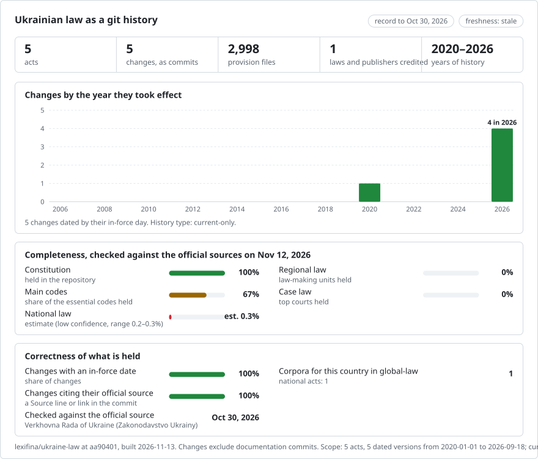

# Ukraine: law history in git

**English** · **[Або читайте українською](README.md)**

<picture>
<source media="(prefers-color-scheme: dark)" srcset="data/effort-dark.svg">

</picture>

The law of Ukraine as a git history: one file per article, one commit per version on the day it took effect, and the act that made each change as the commit's author (the publisher, for the oldest version available). `git blame` names the version behind every line; `git log` lists every change to an article; picking a date gives the text in force that day.

Part of [lexifina/global-law](https://github.com/lexifina/global-law), one git history for every country's law: this is Ukraine's national law, which global-law reads at `ukraine/national/acts/`.

**What is in it now:** the Constitution and four codes (the Civil, Criminal, Criminal Procedure and Labour Codes), each in one version, the revision in force when it was read: 2,993 articles and other provisions in all. [`REPRODUCE.md`](REPRODUCE.md) lists each act with its version and how it was built.

Each act is a folder (`labour-code/` is the Кодекс законів про працю України, the Labour Code, 322-VIII of 10 December 1971) with one file per article (`art-001.md`; `art-002-1.md` is Article 2-1) and one for its final or transitional provisions; the folder's `README.md` lists its articles.

The text is in Ukrainian, as zakon.rada.gov.ua publishes it. An English translation is not part of this record.

## Questions as git commands

| Question | Command |
| --- | --- |
| Every change to Article 1 of the Labour Code | `git log -p --word-diff -- labour-code/art-001.md` |
| Which act wrote each line of Article 1? | `git blame labour-code/art-001.md` |
| Every version of the Labour Code, with the day each took effect | `git log --format="%h %(trailers:key=In-force,valueonly,separator=) %an" -- labour-code ':!labour-code/README.md'` |
| Article 1 as in force on 1 November 2026 | `python tools/on.py 2026-11-01 labour-code art-001` |

**Outside git**, we also host this record publicly, for free:

- **[Ask Claude about Ukrainian law](https://global-law.lexifina.com/v1/try_claude?country=ukraine)**: opens Claude with a first question ready.
- **[Ask ChatGPT](https://global-law.lexifina.com/v1/try_chatgpt?country=ukraine)**: the same question in ChatGPT.
- **[Call the API in your browser](https://global-law.lexifina.com/v1/search_law?query=%D1%89%D0%BE%D1%80%D1%96%D1%87%D0%BD%D0%B0+%D0%B2%D1%96%D0%B4%D0%BF%D1%83%D1%81%D1%82%D0%BA%D0%B0&jurisdictions=ukraine)**: a search of Ukrainian law for "щорічна відпустка" (annual leave), returned as JSON. See the [documentation here](https://lexifina.com/api/global-law).

Both assistants read the record through the free Global law connector (MCP, `https://global-law.lexifina.com/mcp`); the first time, the chat gives you the link that adds it. Ask in Ukrainian or in English.

**Host it yourself easily.** All it takes is git and Python, and the tools run on your machine:

```sh
git clone --depth 1 https://github.com/lexifina/global-law && cd global-law
python3 tools/countries.py add ukraine/national/acts
python3 tools/law.py show 2026-11-01 ukraine/national/acts/labour-code/art-001.md
```

Opened in Claude Code, Cursor, VS Code or Codex, the clone also starts a local MCP server with the same tools ([MCP.md](https://github.com/lexifina/global-law/blob/main/MCP.md)).

## Dates

Each commit is dated at noon, Europe/Kyiv, on the day the version took effect, and carries it in its `In-force:` trailer:

- each version is the revision zakon.rada.gov.ua shows ("Редакція від ..."), dated as the site dates it: from the day the law or decision that made it took effect, which the commit message names (the Labour Code's is the revision of 31 July 2026, basis Law 4742-IX);
- the Constitution's version is its revision of 1 January 2020 (Law 27-IX of 3 September 2019); the Criminal Procedure Code's is dated 21 July 2026, the day of a Constitutional Court decision declaring some of its provisions unconstitutional.

Each act's one version is its "oldest version available", credited to the publisher, the Verkhovna Rada of Ukraine (Zakonodavstvo Ukrainy); when later versions are added, each is credited to the law that made it.

## How it is checked

- Every version is read back from git on the day it took effect and on the day before, and must match the corpus it was built from (`tools/check_repo.py`): 5 versions of 5 acts, 0 mismatches.
- A second build from the same corpus gave identical hashes for every history commit and tag. Results are in `REPRODUCE.md`.
- History is append-only: no merge commits, commit dates never go backwards, no commit dated in the future, and every commit's trailers parse.
- The wording of the law is not changed: chapter headings, the site's editorial notes in braces and the list of amending laws are left out, and spacing, quotes and dashes are normalised (see `LICENSE`).

## What it does not show

- **Earlier versions.** Each act is here only in the revision in force when it was read; zakon.rada.gov.ua lists earlier revisions of each (for the Constitution, those of 1996, 2006, 2010, 2011, 2013, 2014, 2016 and 2019), not built yet.
- **Which law made each change.** With one version per act, `git blame` names the publisher for every line, not the amending law.
- **Other law.** Only these five acts are here: no other laws or by-laws, local acts, case law or treaties. The Commercial Code (Господарський кодекс) is not included: it ceased to be in force on 28 August 2025.
- **Headings and notes.** Chapter headings and the site's notes in braces are not in the files; Articles 121-123 of the Constitution were repealed with Chapter VII in 2016 and are not in the text.

## Sources

| Source | Kind | Past versions | Notes |
| --- | --- | --- | --- |
| [Законодавство України](https://zakon.rada.gov.ua) (Verkhovna Rada of Ukraine) | Official legislation database | the site lists every revision; one per act is built | The current revision of each act, read from Internet Archive captures of October 2026 |

## Licence

See [`LICENSE`](LICENSE). The text of a law is an official document; the Verkhovna Rada publishes its open data under CC BY 4.0, and `LICENSE` gives the attribution. Lexifina's own contributions (the arrangement of the history, the commit messages, the tables and the tools) are CC0 1.0.

No AI model wrote, translated or corrected legal text, and none runs when the history is built; the scripts were written by an AI model (see [`REPRODUCE.md`](REPRODUCE.md)).

## More

From [lexifina/global-law](https://github.com/lexifina/global-law):

- [FEATURES.md](https://github.com/lexifina/global-law/blob/main/FEATURES.md): every feature, and what every corpus must support (`git blame`, `law.py`, the MCP tools)
- [FAQ.md](https://github.com/lexifina/global-law/blob/main/FAQ.md): questions and answers · [CONTRIBUTING.md](https://github.com/lexifina/global-law/blob/main/CONTRIBUTING.md): proposing changes · [MCP.md](https://github.com/lexifina/global-law/blob/main/MCP.md): the MCP server · [REPRODUCE.md](https://github.com/lexifina/global-law/blob/main/REPRODUCE.md): how it was built · [CHANGELOG.md](https://github.com/lexifina/global-law/blob/main/CHANGELOG.md)
- [FRESHNESS.md](https://github.com/lexifina/global-law/blob/main/FRESHNESS.md): how current each corpus is · [Monitoring](https://github.com/lexifina/global-law/tree/main/monitoring): whether updates are running · [WATCHING.md](https://github.com/lexifina/global-law/blob/main/WATCHING.md): how each official source is watched for changes
- [performance/](https://github.com/lexifina/global-law/tree/main/performance): how fast the tools are, measured
- [visualisations/](https://github.com/lexifina/global-law/tree/main/visualisations): charts and bridges across the world's law
- [Vulnerabilities](https://github.com/lexifina/global-law/tree/main/vulnerabilities): mistakes in legislation as published
