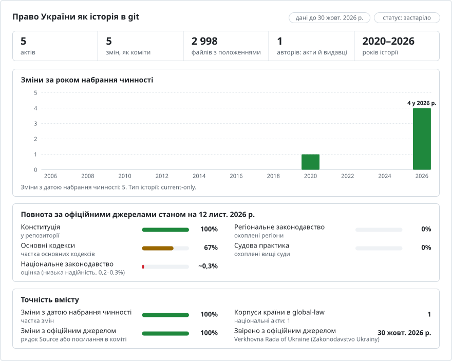

# Україна: історія законодавства в git

**Українська** · [English](README.en.md)

<picture>
<source media="(prefers-color-scheme: dark)" srcset="data/uk/effort-dark.svg">

</picture>

Частина проєкту [lexifina/global-law](https://github.com/lexifina/global-law), єдиної git-історії права всіх країн: це національне законодавство України, яке global-law читає за шляхом `ukraine/national/acts/`.

Законодавство України як git-історія: один файл на кожне положення, один коміт на кожен закон чи рішення в день набрання ним чинності, а автор коміту — закон, яким внесено зміну. `git blame` називає закон, що стоїть за кожним абзацом; `git log` показує кожну зміну положення; `tools/on.py` видає текст, чинний на будь-який день.

Він дотримується спільної структури [lexifina/global-law](https://github.com/lexifina/global-law), яка розміщує його за шляхом `ua/`.

> **Перша збірка.** Текст — Конституція України в тому вигляді, як її опубліковано Верховною Радою на zakon.rada.gov.ua. Ця перша збірка містить одну версію — чинну редакцію; на сайті наведено попередні редакції (1996, 2006, 2010, 2011, 2013, 2014, 2016, 2019), які ще не зібрано, а із законів зібрано лише ті, що перелічені нижче.

Мова: текст українською (офіційною мовою акта); цей README — переклад англійської версії.

**Що в ньому є зараз**

| Тека | Акт | Версій | Історія |
| --- | --- | ---: | --- |
| `constitution/` | Конституція України (1996), чинна редакція | 1 | Найдавніша доступна версія, датована 1 січня 2020 року, — редакція, яку показує сайт Верховної Ради (підстава: Закон № 27-IX від 3 вересня 2019 року); 161 стаття з їхніми пронумерованими частинами та перехідні положення |
| `criminal-code/` | Кримінальний кодекс України (Закон № 2341-III від 5 квітня 2001 року) | 1 | Найдавніша доступна версія, датована 18 вересня 2026 року, — редакція, яку показує сайт Верховної Ради (підстава: Закон № 4986-IX); близько 540 статей, а також прикінцеві та перехідні положення |
| `civil-code/` | Цивільний кодекс України (Закон № 435-IV від 16 січня 2003 року) | 1 | Найдавніша доступна версія, датована 5 серпня 2026 року, — редакція, яку показує сайт Верховної Ради (підстава: Закон № 2541-IX); близько 1 300 статей і прикінцеві положення |
| `criminal-procedure-code/` | Кримінальний процесуальний кодекс України (Закон № 4651-VI від 13 квітня 2012 року) | 1 | Найдавніша доступна версія, датована 21 липня 2026 року, — редакція, яку показує сайт Верховної Ради (рішення Конституційного Суду від того дня, яким положення визнано неконституційними); близько 680 статей, а також прикінцеві та перехідні положення |
| `labour-code/` | Кодекс законів про працю України (1971) | 1 | Найдавніша доступна версія, датована 31 липня 2026 року, — редакція, яку показує сайт Верховної Ради (підстава: Закон № 4742-IX); близько 290 статей і прикінцеві положення |

## Запитання як команди git

| Запитання | Команда |
| --- | --- |
| Увесь акт на дату | `python tools/on.py 2024-01-01 constitution` |
| Одне положення на дату | `python tools/on.py 2024-01-01 constitution <unit>` (unit — назва файлу без `.md`) |
| Який закон написав кожен рядок положення? | `git blame constitution/<unit>.md` |
| Кожна зміна положення, слово за словом | `git log -p --word-diff constitution/<unit>.md` |
| Кожен закон в історії, по порядку | `git log --reverse --format="%ad %an" --date=short main` |

Після перезбирання оновіть теги командою `git fetch --force --tags`: звичайний fetch залишає застарілі теги.

## Чого він не показує

- **Одна версія.** Зібрано лише чинну редакцію. Конституція в редакції, ухваленій у 1996 році, та редакції 2006, 2010, 2011, 2013, 2014, 2016 і 2019 років не показані як окремі версії; єдина версія датована 1 січня 2020 року, а її автором зазначено видавця («найдавніша доступна версія»).
- **Довідковий апарат.** Заголовки розділів, перелік законів, якими внесено зміни, редакційні примітки у фігурних дужках і нижній колонтитул сайту не включено. Статті 121–123 виключено разом із розділом VII у 2016 році, і їх немає в тексті.
- **Закони.** Включено лише кодекси, перелічені в таблиці, кожен однією версією (чинною редакцією); Господарський кодекс не включено, оскільки він втратив чинність 28 серпня 2025 року.

## Як його зібрано

Lexifina читає наведені тут джерела й записує датовані версії кожного акта та закони, якими внесено кожну зміну, в один файл корпусу. `tools/build.py` створює цей репозиторій із цього файлу, і той самий корпус завжди дає ті самі хеші комітів; `REPRODUCE.md` описує подробиці й перевірки. Код Lexifina написала модель (Claude); жодного юридичного тексту вона не писала, і під час збирання історії жодна модель не працює.

Код Lexifina читає збережену сторінку Конституції та записує `corpus.json`; `parse_parts.py` читає збережені сторінки кодексів і записує окрему частину `corpus.d/` для кожного кодексу. Спільний збирач перетворює `corpus.json` на коміти; `REPRODUCE.md` перелічує джерела, команди й ухвалені рішення, а також результати перевірок (кожну версію прочитано назад із git у день набрання нею чинності та напередодні, трейлери розібрано, merge-комітів немає, дати ніколи не йдуть назад).

## Джерела

| Джерело | Що | Примітки |
| --- | --- | --- |
| [Верховна Рада України, «Законодавство України»](https://zakon.rada.gov.ua/laws/show/254%D0%BA/96-%D0%B2%D1%80) | Конституція України, редакція від 01.01.2020 | Відкриті дані Ради поширюються на умовах CC BY 4.0. |
| [Верховна Рада України, «Законодавство України»](https://zakon.rada.gov.ua/laws/show/2341-14) | Кримінальний кодекс України (2341-III від 5 квітня 2001 року), чинна редакція | – |
| [Верховна Рада України, «Законодавство України»](https://zakon.rada.gov.ua/laws/show/435-15) | Цивільний кодекс України (435-IV від 16 січня 2003 року), чинна редакція | – |
| [Верховна Рада України, «Законодавство України»](https://zakon.rada.gov.ua/laws/show/4651-17) | Кримінальний процесуальний кодекс України (4651-VI від 13 квітня 2012 року), чинна редакція | – |
| [Верховна Рада України, «Законодавство України»](https://zakon.rada.gov.ua/laws/show/322-08) | Кодекс законів про працю України (322-VIII від 10 грудня 1971 року), чинна редакція | – |

Відомості про зазначення авторства наведено у файлі `LICENSE`.

Це переклад англійської версії ([README.en.md](README.en.md)); у разі розбіжностей переважає англійська версія.

## Більше

З репозиторію [lexifina/global-law](https://github.com/lexifina/global-law) (англійською):

- [FEATURES.md](https://github.com/lexifina/global-law/blob/main/FEATURES.md): усі функції та що має підтримувати кожен корпус (`git blame`, `law.py`, інструменти MCP)
- [FAQ.md](https://github.com/lexifina/global-law/blob/main/FAQ.md): запитання й відповіді · [CONTRIBUTING.md](https://github.com/lexifina/global-law/blob/main/CONTRIBUTING.md): як запропонувати зміни · [MCP.md](https://github.com/lexifina/global-law/blob/main/MCP.md): MCP-сервер · [REPRODUCE.md](https://github.com/lexifina/global-law/blob/main/REPRODUCE.md): як його зібрано · [CHANGELOG.md](https://github.com/lexifina/global-law/blob/main/CHANGELOG.md)
- [FRESHNESS.md](https://github.com/lexifina/global-law/blob/main/FRESHNESS.md): наскільки актуальний кожен корпус · [Моніторинг](https://github.com/lexifina/global-law/tree/main/monitoring): чи працюють оновлення · [WATCHING.md](https://github.com/lexifina/global-law/blob/main/WATCHING.md): як кожне офіційне джерело відстежується на зміни
- [performance/](https://github.com/lexifina/global-law/tree/main/performance): наскільки швидкі інструменти, за вимірами
- [visualisations/](https://github.com/lexifina/global-law/tree/main/visualisations): графіки та зв’язки в праві всього світу
- [Вразливості](https://github.com/lexifina/global-law/tree/main/vulnerabilities): помилки в актах у тому вигляді, як їх опубліковано
